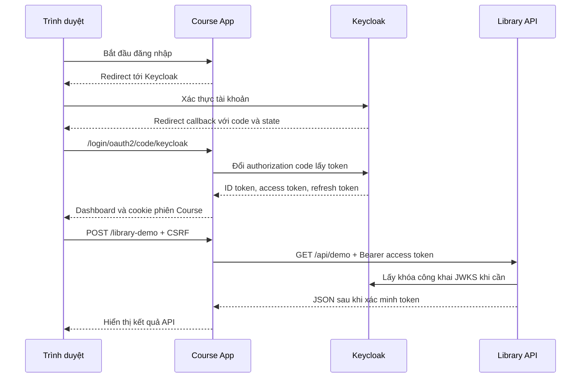

# Kịch bản trình diễn ABJet

Điều kiện: Keycloak realm/client/audience đã cấu hình, hai app đang chạy và cùng dùng `localhost`.

## 1. Authentication

Mở cửa sổ ẩn danh, vào Course App `http://localhost:8081`, truy cập dashboard khi chưa đăng nhập để thấy ứng dụng yêu cầu xác thực. Bấm đăng nhập, nhập tài khoản ở giao diện Keycloak, rồi xem tên/email ở dashboard.

Mật khẩu được nhập tại Keycloak, không nhập hoặc lưu ở Course/Library.

## 2. OAuth 2.0 và OIDC Authorization Code



Code chỉ dùng để đổi token, không phải access token. OIDC bổ sung xác thực danh tính trên nền OAuth 2.0.

Bấm **Gọi API Library** ở Course dashboard. Kết quả HTTP 200 cho thấy access token được API chấp nhận. Backend Spring Security quản lý authorized client và làm mới access token khi cần, nếu refresh token/phiên vẫn hợp lệ.

Ở terminal, thử API không có token:

```powershell
curl.exe -i http://localhost:8082/api/demo
```

Kết quả mong đợi: HTTP 401, không redirect sang trang login. Kể cả đã đăng nhập Library trong trình duyệt, truy cập trực tiếp `/api/demo` bằng cookie phiên vẫn bị từ chối.

Test tự động còn kiểm tra token sai chữ ký, hết hạn, sai issuer, sai audience, token hỏng và ID token dùng thay access token.

Không thêm role/scope nghiệp vụ: API demo chấp nhận access token hợp lệ dành cho Library. Đây là minh họa quyền truy cập bằng bearer token, chưa phải hệ thống phân quyền nghiệp vụ.

## 3. ID Token

Ở dashboard, đọc các claim lấy từ ID token:

| Claim | Ý nghĩa |
|---|---|
| `iss` | Realm Keycloak phát hành token |
| `sub` | Định danh người dùng trong issuer |
| `aud` | Client nhận ID token: Course hoặc Library |
| `iat` | Thời điểm phát hành |
| `exp` | Thời điểm hết hạn |

ID token phục vụ xác thực danh tính với OIDC client. Access token phục vụ truy cập API; không hoán đổi vai trò. Giao diện chỉ hiển thị claim chọn lọc, không hiển thị token nguyên văn.

## 4. SSO

Từ dashboard Course, mở Library App trong cùng cửa sổ trình duyệt và bấm đăng nhập. Keycloak nhận ra phiên SSO nên thường không yêu cầu nhập lại mật khẩu; Library tạo phiên riêng rồi hiển thị cùng người dùng.

Library vẫn chạy luồng Authorization Code của client `library-app`. Hai app không chia sẻ session hoặc token trực tiếp; phiên SSO nằm ở Keycloak.

Cookie phiên riêng: `COURSESESSION` và `LIBRARYSESSION`. Cookie localhost không được tách theo port nên hai app cần tên khác nhau.

## 5. Logout cục bộ

Đăng xuất Course: dashboard Course yêu cầu đăng nhập lại, còn phiên Library vẫn hoạt động. Keycloak SSO vẫn còn nên đăng nhập Course lại có thể không hỏi mật khẩu.

Không trình bày thao tác này là global logout. Muốn bắt đầu lại hoàn toàn, đóng cửa sổ ẩn danh rồi mở cửa sổ mới.

## Giới hạn xác minh

Maven tests kiểm tra route, CSRF, dữ liệu danh tính, HTTP bearer và xác minh JWT bằng RSA/JWKS local. Đăng nhập và SSO với Keycloak thật phải kiểm tra bằng các thao tác trên sau khi cấu hình local; không suy ra SSO đã chạy chỉ từ tests.
